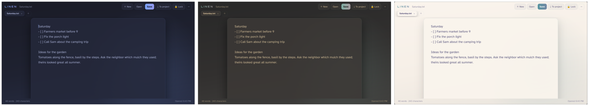

# Linen

**Calm notes that wear your theme.** A soft, clean writing app for notes, lists and passwords on [Omarchy](https://omarchy.org). It takes on your running Omarchy theme's colors and changes with it live when you switch themes. Linen's own Dusk and Dawn themes are one click away.



- **Spelling** underlined as you type (en_US via enchant/hunspell). Contractions are fine. Right-click a misspelled word for suggestions, or "Learn Spelling" to add it to your dictionary.
- **Tabs**, restored after a restart. Opened files autosave as you type and warn you if the file changed on disk. Unsaved notes are kept in a private session file until you save them.
- **Right-click helpers:** ✨ Fix spelling & grammar, Synonyms, Rewrite (shorter, friendly, professional, bullets, summary, Obsidian note), Insert (date, time, checkbox, divider, strong password), Copy as plain text, Count words, Save to project or Obsidian. Optional text cleanups through the separate `rinse` tool.
- **AI is offline and optional:** it uses Ollama on your own computer (default model `qwen3:4b-instruct`). Nothing leaves the computer. Without Ollama, everything else works.
- **🔒 Lock:** password-protects a note with GPG (AES-256, symmetric). The note becomes `<name>.gpg`; the plain copy is removed only after the locked copy is checked to open. Locked notes autosave still locked, are never copied unlocked (To project, Save as and Save to Obsidian are blocked), and never go in the session file. The password goes to gpg on stdin with `--no-symkey-cache`. Open one anywhere with `gpg -d "note.txt.gpg"`. **A forgotten password can't be recovered.**
- **Private by design:** the window talks to its own local server (127.0.0.1 only, a fresh secret per launch, refuses anything not addressed to it). New files are private (0600) and never overwrite.

## Install

On Omarchy (Arch):

```sh
omarchy pkg add rust gtk4 webkitgtk-6.0 gnupg zenity enchant hunspell-en_us
git clone https://github.com/CodeFu72/linen && cd linen && bash scripts/install.sh
```

Then open **Linen** from the app launcher, or run `linen`. Optional: `omarchy pkg add ollama` for the AI helpers (pull a model such as `qwen3:4b-instruct`).

**Folders:** Save to project lists folders in `~/Projects` (or `LINEN_PROJECTS`); with none there, Save opens a normal Save box. Save to Obsidian asks for your vault the first time and remembers it (`vault_dir` in `~/.config/linen/settings.json`, or `LINEN_VAULT`).

**Tested on:** Omarchy on a ThinkPad T14 Gen 1. Early version; tell me how it goes on yours.

## Keys

Ctrl+N / Ctrl+T new tab · Ctrl+Tab next tab · Ctrl+1–9 jump to a tab · Ctrl+O open · Ctrl+S save · Ctrl+Shift+S save as · Ctrl+P save to project · Ctrl+L lock · Ctrl+W close tab · Ctrl + / Ctrl − text size · Esc closes menus and boxes.

## Layout

- `src/main.rs`: GTK window, WebKit view, right-click menu (`build_menu`), CLI (`linen`, `linen serve`, `linen password N`).
- `src/server.rs`: loopback-only HTTP server with a per-run token; serves `ui/` and the `/api/*` calls. It answers only requests addressed to `127.0.0.1:<port>`, and the token is placed into Linen's own window by `main.rs`, never served in the page (except `linen serve`, for development).
- `src/files.rs`: open, save (atomic, keeps permissions, warns on outside changes), Save to project / Obsidian, lock and unlock, settings and session.
- `src/lock.rs`: the gpg calls.
- `src/theme.rs`: maps the running Omarchy palette (`~/.local/state/omarchy/current/theme/colors.toml`) onto Linen's colors; `main.rs` watches that folder with inotify (no polling) and recolors the page when the theme changes.
- `src/ai.rs`: offline helpers through Ollama on 127.0.0.1 (default model `qwen3:4b-instruct`).
- `ui/`: `index.html`, `app.js`, `app.css`, fonts and icon, compiled into the binary.

Tests: `cargo test` (20; the GPG tests use their own throwaway key folder, never `~/.gnupg`). When testing the UI, use a sandbox `HOME` and `GNUPGHOME` (create it first), but don't call the AI under a fake `HOME`: it starts an Ollama that can't see the models in `~/.ollama`.

`scripts/install.sh` builds and installs it with a launcher entry. `linen password 24` prints a strong password.

## Credit

Made by Kirk Fuson ([EchoLine](https://echoline.digital)). MIT licensed; see [LICENSE](LICENSE). Fonts: Atkinson Hyperlegible and Orbitron (SIL Open Font License, see `ui/fonts`).
